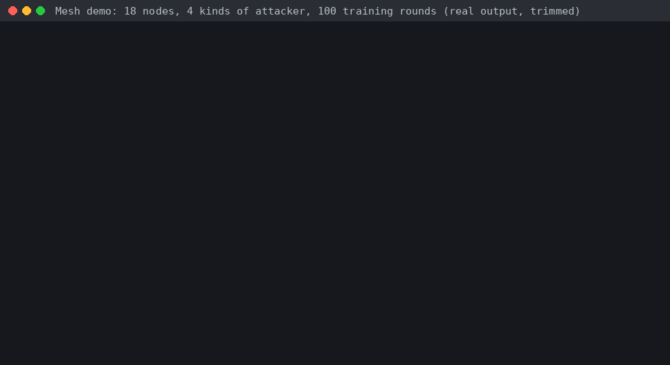

# Swarm & Mesh: decentralized AI prototypes

[](https://github.com/Davy765/mesh-/actions/workflows/tests.yml)
[](LICENSE)
[](https://codespaces.new/Davy765/mesh-?quickstart=1)



**Try it in your browser:** click "Open in GitHub Codespaces" above, wait for it to set up, then type
`python simulate_mesh.py` in the terminal. Nothing to install; it runs on GitHub's free Codespaces allowance.

> [!WARNING]
> **Research prototype.** Mesh is unaudited. Its tokens are play money: don't attach real value to them, and don't
> train it on sensitive data. See [SECURITY.md](SECURITY.md) and the [threat model](docs/THREAT_MODEL.md).

> **Get involved.** This is an open research prototype with real unsolved problems: attacks to find, defences
> to design, experiments to run. Newcomers are welcome.
> - Start with an issue labelled [`good first issue`](https://github.com/Davy765/mesh-/issues?q=is%3Aissue+is%3Aopen+label%3A%22good+first+issue%22),
>   or pick a bigger open problem labelled [`help wanted`](https://github.com/Davy765/mesh-/issues?q=is%3Aissue+is%3Aopen+label%3A%22help+wanted%22).
> - [CONTRIBUTING.md](CONTRIBUTING.md) explains how to set up, test and send a pull request.
> - Found a way to break one of Mesh's defences? [Report the attack](https://github.com/Davy765/mesh-/issues/new?template=attack.md); that's one of the most useful contributions.

Two prototypes in Python (needs `numpy` and `cryptography`: `pip install -r requirements.txt`).

| | What it is | Run it |
| --- | --- | --- |
| **Swarm** (`swarm/`) | Peers learn one model together by gossiping weights. Simple and small. | `python simulate.py` |
| **Mesh** (`mesh/`) | One model **split across many servers**, trained by agents with private data, coordinated and paid through a **small blockchain**, with defences against cheating. | `python simulate_mesh.py` |

Tests: `python -m unittest discover -s tests` (35 tests, about 30 s). They also run automatically on every pull request.

---

## Mesh: how it works

```
 agent (private data)                          slice servers (3 replicas per slice)          validators
 ┌────────────────────┐   encrypted, signed   ┌─────────┐   ┌─────────┐   ┌─────────┐      ┌───────────┐
 │ input layer  ──────┼──────────────────────▶│ slice 0 │──▶│ slice 1 │──▶│ slice 2 │─┐    │  ledger:  │
 │ output layer ◀─────┼───────────────────────┴─────────┴───┴─────────┴───┴─────────┘ │    │  stakes,  │
 │ (never leaves)     │◀──────────────────────────────────────────────────────────────┘    │  payments,│
 └────────────────────┘          each answer comes with a signed receipt                  │  votes,   │
          │  pays per receipt, reports cheats, votes on updates  ──────────────────────▶  │  slashing │
                                                                                          └───────────┘
```

- **Split model.** The input and output layers stay on each agent's machine. The middle of the network is cut into
  3 slices, and each slice is held by 3 independent servers. A request runs through one server per slice.
- **Training.** In each round, every agent runs a training batch through the slices.
  1. **Slices are trained verifiably.** Each agent sends its training step for a slice to *every* server holding
     that slice and declares a fingerprint of those inputs on the chain. Every server turns exactly the declared
     inputs into an update, fetching anything it missed from the agent and checking it against the fingerprint.
     Honest servers therefore compute bit-identical new weights, and the chain keeps the version a majority
     computed. A server that computes anything else is outvoted, earns nothing and has to resync. Because all
     servers answer every training step, the agent also cross-checks them on every step, not just a sample.
  2. **Agents' own layers are trust-weighted.** An agent's update to the input and output layers comes from private
     data, so nobody can recompute it. Instead it is scored by how well it agrees in direction with a training
     step on a small **public seed set** (20 labelled examples per class, fixed at genesis). An update pointing the
     opposite way gets zero weight; this is the FLTrust approach. Updates are published only after everyone has
     committed to a hash of theirs, so nobody can copy another's update or react to it.
  3. **Vote.** Each agent measures how the candidate changes its own held-out loss, relative to the current model.
     The chain takes a **trimmed average** of these reports, ignoring the most extreme ones, and rejects the round
     only if it makes things more than 25% worse network-wide. Ordinary training steps often raise the loss a
     little and still make progress overall, so a stricter check throws away real learning. After a rejected
     round, everyone takes a smaller step.
- **Blockchain.** 4 validators each re-run every block, and a block counts only if 3 of them reach the same result.
  The chain stores stakes, public keys, reputation and payments, plus *hashes* of model versions and work receipts.
  It never stores or runs the model.
- **Agents.** They train, pay for compute, and hire each other through a job market: the poster escrows the
  payment, a worker does the job, the poster spot-checks it, and then either pays or proves the work was wrong.

## Mesh: the problems and what each fix achieves

| Problem | What Mesh does | Status |
| --- | --- | --- |
| Shared password = everyone trusted (Swarm) | Each participant has its own Ed25519 identity, registered on chain with a stake. Unregistered senders are refused. | **Fixed** |
| Messages in plain JSON over HTTP (Swarm) | Binary arrays (no pickle), AES-256-GCM encryption per pair of peers, signatures, and replay protection, over raw TCP or HTTP(S). An eavesdropper on every link captured 600 MB and could read none of the payloads. | **Fixed** |
| Everyone must agree on the model (Swarm) | The genesis block fixes the architecture, seed and hash of every piece. A node whose starting weights don't match refuses to start. | **Fixed** |
| One machine can't hold a big model | It's split into slices with 3 replicas each. If a server crashes, requests fail over to another replica. | **Fixed** (at toy scale) |
| Can't tell if a server did the work correctly | Every answer carries a signed receipt. Every training step goes to all replicas and is compared, and 15% of inference hops are re-run on another replica. When 2 replicas agree against a third, the receipts prove it and the chain slashes the liar. In the demo, the lying server was caught at block 3 and agents then routed around it. | **Training: fixed. Inference: mitigated** (sampled, so high probability, not certainty). Needs an honest majority per slice. |
| Poisoned training updates from **servers** | Slice updates are recomputed by every replica from the same declared inputs, and the majority's result wins. The poisoning server was outvoted in **every round**: 100/100 on the toy task, 150/150 on MNIST and 42/42 on the real network. | **Fixed**, given an honest majority of each slice's replicas |
| Different hardware computing slightly different results | Weight updates are snapped to a fixed 2^-24 grid before they are applied and hashed, and spot checks compare results rounded to 4 decimals, so last-bit differences between honest machines almost never change a hash. A test makes one replica per slice compute with a 1e-12 error: without rounding it is outvoted, with rounding everyone agrees and nobody is slashed. | **Mitigated**: tested against simulated differences, not yet on two physically different machines. A rare round that still splits just fails and the next one retries. |
| Withholding: sending inputs or salts to only some replicas | Two colluding agents could stall training completely this way (a test reproduces it). Replicas now fetch anything they were left out of from other replicas, and the on-chain fingerprint proves it is genuine. | **Fixed** (tested) |
| A node restarts | Validators save every block to disk, replay it on restart (re-checking signatures and results), then fetch what they missed. Servers and agents rejoin and download the agreed weights, hash-checked. The multi-process demo kills and restarts a validator and a server and checks both catch up. | **Fixed** |
| One file held every node's private key | Each node now makes its own key file on its own machine (`mesh.run keygen`); the network config is built from public cards only. | **Fixed** |
| Poisoned training updates from **agents** | Their updates come from private data, so they're trust-weighted against a public seed set. Updates that point the wrong way get zero weight. The cheating agent was excluded in 91–150 of the rounds, depending on the run. Honest agents with unusual data are sometimes down-weighted too. | **Mitigated**: it needs a small public labelled set. A saboteur can't damage what others teach, but if it is the *only* holder of some data (digits 4 and 9 in the MNIST demo), nobody else can teach the model that. |
| Speed of an internet-wide pipeline | Inference routes to the fastest trustworthy replica: **249 ms per hop** against 284 ms random, with 244 ms the best possible. Micro-batches pipeline through the slices: one job chunk took **1.8 s instead of 3.1 s**. | **Mitigated**: an internet pipeline is still much slower than one datacenter. That part is physics. |
| Incentives can be gamed | Joining needs a stake, which makes fake identities costly. Pay is per signed receipt, settled once per round. Training rewards go only to updates that were kept, in proportion to paid work. Cheaters are slashed and the reporter gets a bounty. | **Mitigated**: the prices and penalties are untested against real, motivated attackers. |
| Blockchain too slow for AI | Only hashes, Merkle roots and one batched payment per agent per round go on chain. | **Fixed** by design |
| Dishonest validator | The other 3 re-run each block and refuse forged ones (76 refused in the demo; the forger minted nothing). | **Fixed** for 1 bad validator in 4 (no full BFT view-change) |
| Servers can learn about your data | Raw data and final answers never leave the agent. Optional noise on activations, and optional differential privacy with an epsilon accountant. | **Partial**: servers still see hidden-layer activations. With 5 agents, strong DP costs too much accuracy (see below). Real fixes (secure computation, secure hardware) aren't built. |

### Measured results (`python simulate_mesh.py`, 100 rounds, about 25 s)

| Run | Test accuracy |
| --- | --- |
| Everyone honest (`--no-attackers`) | 93.4% |
| Lying server, poisoning server, cheating agent, forging validator and a crash, all at once | 94.2% |
| `--activation-noise 0.5` | 93.5% (but only 75% when the noise is also applied at inference) |
| `--privacy 0.3` (ε ≈ 2,560) | 88.8% (measured before the strict vote; likely higher now) |
| `--privacy 1.0` (ε ≈ 298) | 83–95% over 4 runs (the noise differs every run). It used to collapse to 34%: the 25% vote let very noisy steps through, so with privacy noise on the vote is now strict (any step that makes things worse is rejected). |

Each agent alone (only 2 of the 4 classes) gets about 49%. Smaller ε means stronger privacy; useful values are under 10.
Getting there without losing accuracy takes thousands of participants, not 5.

### Running it as real, separate programs

```bash
python -m mesh.run local --rounds 40          # 21 OS processes on this machine, over raw TCP
python -m mesh.run local --rounds 40 --http   # the same over HTTP
```

Across several machines, private keys never leave the machine that owns them:

```bash
# on each machine, once per node it will run (prints a public card; the key stays in keys/):
python -m mesh.run keygen --name agent2 --role agent --index 2 --endpoint 203.0.113.5:9100 > agent2.card.json
# behind HTTPS, give the public URL as the endpoint and the local address to bind with --listen
# collect the cards (public keys only) anywhere and build the network config:
python -m mesh.run genesis --dir net --cards *.card.json --rounds 40
# copy net/genesis.json and net/nodes.json to every machine, then on each:
python -m mesh.run node --dir net --name agent2 --key keys/agent2.key
```

Each validator, server and agent is its own process listening on its own port. Validators take turns proposing
in fixed time slots, and a dead or forging proposer just loses its slot. Servers and agents read the chain like a
light client: they trust a state hash only if enough validators report it, then check the downloaded state
against that hash. Validators save every block to `net/data/` and replay it after a restart; restarted servers
and agents download the agreed weights. The live ledger state keeps the last 500 rounds; the blocks keep
everything.

The `local` demo kills a server and a validator halfway, and restarts them three-quarters of the way through.
In a 24-round run, accuracy reached 94.3%, the restarted validator caught up to the same block height as the
others, the restarted server resynced and earned rewards again, and no node errors were logged. GitHub runs a
shorter version of this, over TCP and HTTP, on every pull request.

### A public test network

Everything needed to run Mesh as an always-on network that anyone can join, with play-money tokens:

- **`python -m mesh.run join`**: creates your key locally, gets test tokens from the faucet, registers, downloads
  the current weights and takes part, as a slice server, an agent or a validator.
- **Validators can join and leave:** they stake 1,000 test tokens and enter (or leave) the set at the next epoch
  boundary (every 50 blocks); the set never drops below 4.
- **Faucet** (`mesh.run faucet`) for test tokens, and a **live status page** (`mesh.run status`).
- **Deployment kit:** a Dockerfile, a systemd unit, and a step-by-step guide:
  [deploy/TESTNET.md](deploy/TESTNET.md).

Rehearse it on one machine: `python -m mesh.run local --testnet --rounds 20` runs the network with a faucet and a
status page, and partway through a new agent and a new validator join from scratch. In a test run the new validator
entered the set (8 validators, quorum 6), the new agent trained alongside the others, and no node logged an error.
Running it for real needs a few always-on servers (about 4 small cloud servers); see the guide.

### Running on several real machines (GitHub + Tailscale)

The `multi-machine` workflow starts three separate GitHub machines, joins them into a private
[Tailscale](https://tailscale.com) network, and runs the whole system across them. Each machine creates its own
keys; machine 0 collects only the public cards and hands out the network config. Each slice's three servers land on
three different machines, and the report shows which CPU each one ran on, plus whether any honest server was
outvoted (a real-hardware check for [#6](https://github.com/Davy765/mesh-/issues/6)).

One-time setup:
1. Create a free Tailscale account.
2. In the Tailscale admin console, go to **Settings → Keys → Generate auth key**. Turn on **Reusable** and
   **Ephemeral** (so the machines disappear from your network when a run ends), then generate and copy the key.
3. In this repo, go to **Settings → Secrets and variables → Actions → New repository secret**. Name it
   `TS_AUTHKEY` and paste the key.

Then **Actions → multi-machine → Run workflow**. A 30-round run takes about 5 minutes. Each machine's node logs are
kept as artifacts for 7 days; private keys are never uploaded.

`python -m mesh.run cluster` is what each machine runs; it also works on your own computers (`--my-host` is the
address the others reach this machine at, `--coordinator` is machine 0's address and port 9000).

### Not built yet

- **A full BFT protocol** instead of time-slot leader rotation. (Validators can now join and leave.)
- **A colluding majority of one slice's replicas.** With 3 replicas, 2 colluding servers can poison that slice
  undetected. More replicas per slice raise the bar but cost more computing.
- **Hiding who talks to whom.** Traffic is encrypted, but its size and pattern are visible.
- **Large models and GPUs.** The biggest tested model has 2 million parameters, in plain NumPy.
- **A run across physically separate machines** is set up (the `multi-machine` workflow) but hasn't been run yet.

### Code map

| File | What it does |
| --- | --- |
| `mesh/model.py` | The model, cut into ends and slices; stateless forward and backward per slice |
| `mesh/aggregate.py` | Clipping, DP noise, poison-resistant averaging, privacy accountant |
| `mesh/crypto.py`, `mesh/wire.py`, `mesh/network.py` | Keys, signatures, encryption, binary encoding, simulated network |
| `mesh/chain.py` | Ledger state, transactions, validators, 3-of-4 block agreement |
| `mesh/member.py` | The commit / reveal / aggregate / vote round, shared by servers and agents |
| `mesh/server.py` | Slice server: computes, signs receipts, collects gradients |
| `mesh/agent.py` | Agent: routing, failover, spot checks, training, voting, job market |
| `mesh/sim.py` | Builds a whole network in one process, with optional attackers; the public seed set |
| `mesh/datasets.py` | MNIST download (checksum-verified) and the per-class split |
| `mesh/testnet.py` | Faucet, status page and joining a running network |
| `deploy/`, `Dockerfile` | Deployment kit and guide for a public test network |
| `mesh/transport.py`, `mesh/chain_net.py`, `mesh/run.py` | Real networking (TCP or HTTP), networked validators with saved blocks and a light client, key generation, one-process-per-node runner |

---

## Swarm (the simple version)

Each peer trains on its own data, then swaps weights with a random peer and both move halfway toward each other.
They also swap peer lists, so everyone soon knows everyone. A shared key signs messages, and a limit caps how far
one peer can pull another. 8 peers that each see 2 of 4 classes reach about 92.5% together, against 48.6% alone.

```bash
python simulate.py --peers 8 --seconds 15 --secret k --kill 2
```

Each node exposes `GET /info`, `GET /model`, `POST /gossip` and `POST /predict` over HTTP.

---

## License

MIT; see [LICENSE](LICENSE). Contributions are accepted under the same license.
